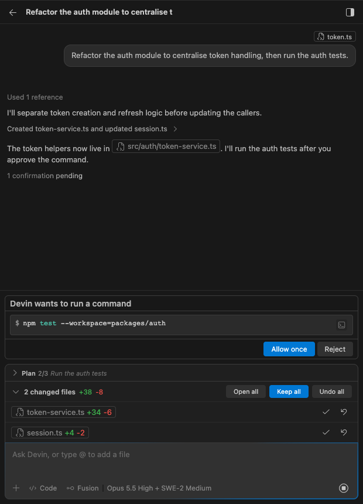
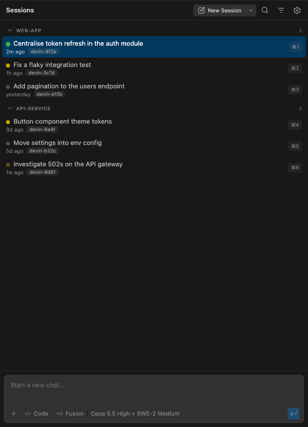
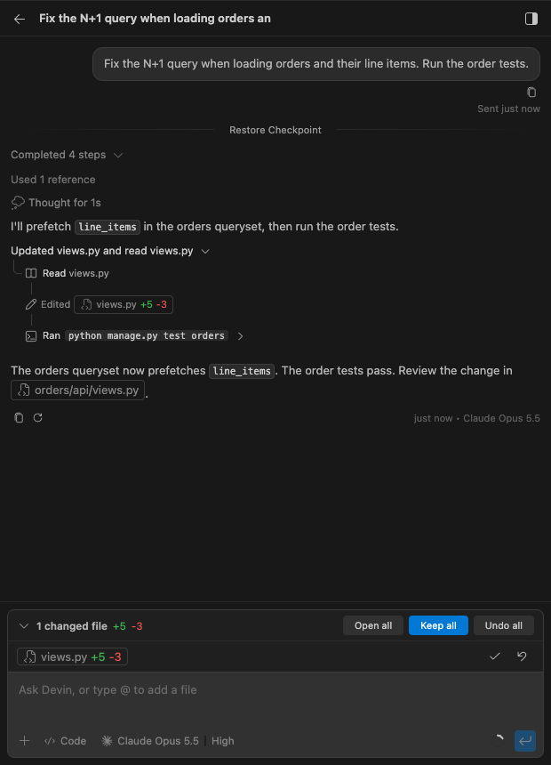
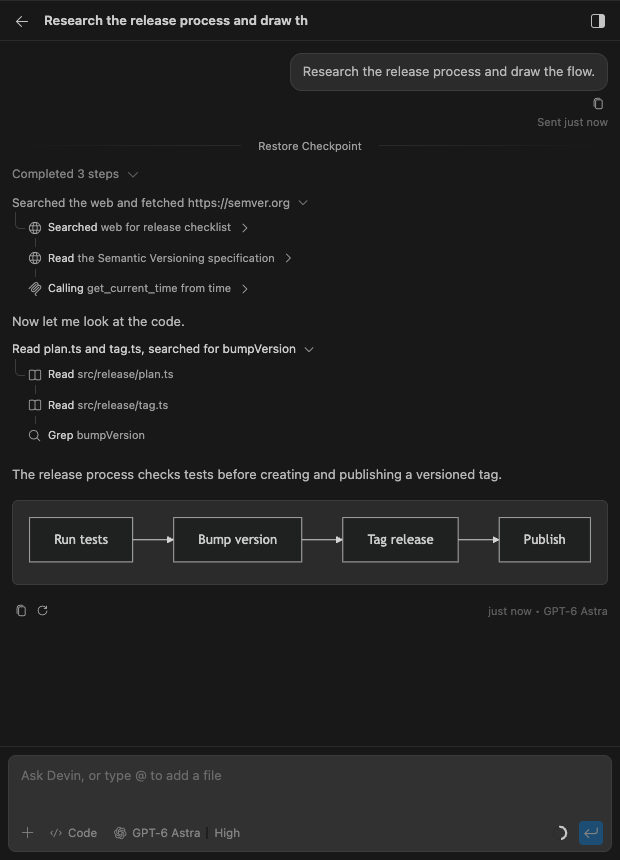

# Devin for VS Code

[](https://marketplace.visualstudio.com/items?itemName=shayanline.devin-vscode)
[](https://marketplace.visualstudio.com/items?itemName=shayanline.devin-vscode)
[](https://github.com/shayanline/devin-vscode/releases/latest)
[](https://github.com/shayanline/devin-vscode/actions/workflows/ci.yml)
[](LICENSE.md)

Devin for VS Code connects your installed [Devin CLI](https://docs.devin.ai/cli) to a chat panel in VS Code. Include workspace files or selected code in a request, then review edits in VS Code diffs with **Keep** and **Undo**. Chats are saved per workspace so you can resume them later.

This is an independent open source extension, currently in preview. It requires Devin CLI and a Devin account with CLI access.



## Features

- **Share editor context.** Attach workspace files and symbols with `@`, or include selected code and VS Code diagnostics. You can also drop files or images into the chat.
- **Review file changes.** Open VS Code diffs from the chat or the Devin source control view, then keep or undo individual files or the current chat's pending changes.
- **Resume workspace sessions.** Search saved chats and filter them by status. Chats can run in the sidebar, an editor tab or a separate window.
- **Follow tool activity.** Read command output and respond to permission requests in the conversation. The available models and modes depend on your installed CLI.
- **Edit CLI configuration.** Manage instructions, skills, plugins, MCP servers, hooks and permissions in the built in settings editor. It updates the same configuration used by Devin CLI in your terminal.

## Screenshots

### Workspace sessions



### Change review



### Tools and diagrams



## Getting started

You need VS Code 1.93 or newer and an installed [Devin CLI](https://docs.devin.ai/cli) that you can sign in to.

1. Install **Devin for VS Code** from the [VS Code Marketplace](https://marketplace.visualstudio.com/items?itemName=shayanline.devin-vscode).
2. Sign in to Devin CLI from a terminal:

   ```sh
   devin auth login
   ```

3. Open a project in VS Code, select the **Devin** icon in the Activity Bar, then enter your request.

The setup screen checks CLI availability and sign in status. If needed, run **Devin: Run Setup** from the Command Palette to select the executable or sign in.

## Permissions and data

The selected CLI mode controls which actions require approval. The default **Code** mode automatically approves workspace edits. **Smart** can approve actions its safety check considers safe, while **Bypass** approves every tool call automatically. Review the mode and permission scope before starting work.

The extension starts Devin CLI locally and has no separate telemetry or analytics client. Context sent to the CLI can be shared with Cognition services and configured MCP servers under their respective policies. Review the [data handling details](docs/usage.md#data-and-privacy) and [Cognition's security guidance](https://docs.devin.ai/admin/security) before using sensitive code or customer data.

## Documentation and support

Read the [usage guide](docs/usage.md) for controls, configuration and troubleshooting. Report extension bugs or request features through the [GitHub issue tracker](https://github.com/shayanline/devin-vscode/issues), using the [support guide](SUPPORT.md) for the details to include.

If you want to contribute, see the [contribution guide](CONTRIBUTING.md). Report vulnerabilities privately using the [security policy](SECURITY.md).

## License

The extension is licensed under [AGPL-3.0-or-later](LICENSE.md), copyright Shayan Khaksar.

Commercial licences are available. [Open an issue](https://github.com/shayanline/devin-vscode/issues) to enquire.
