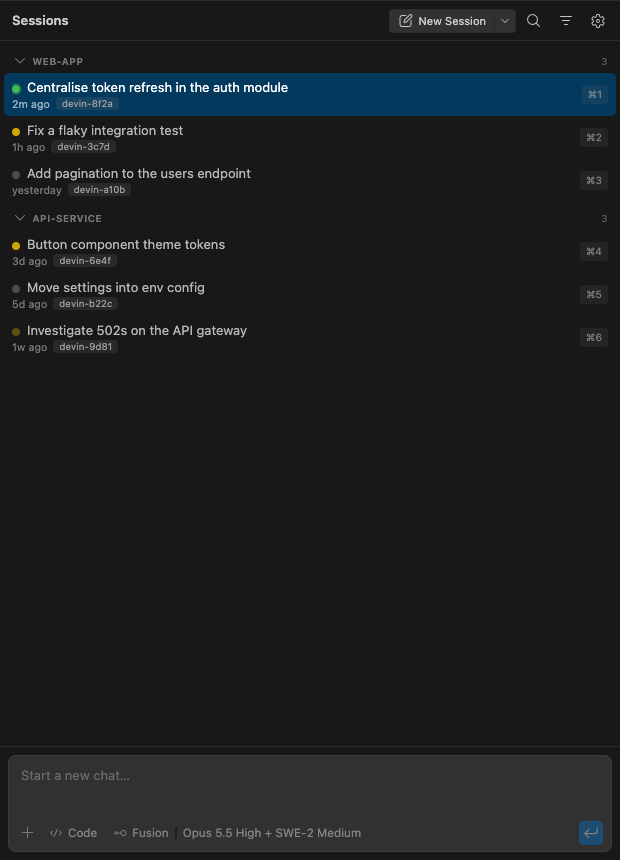
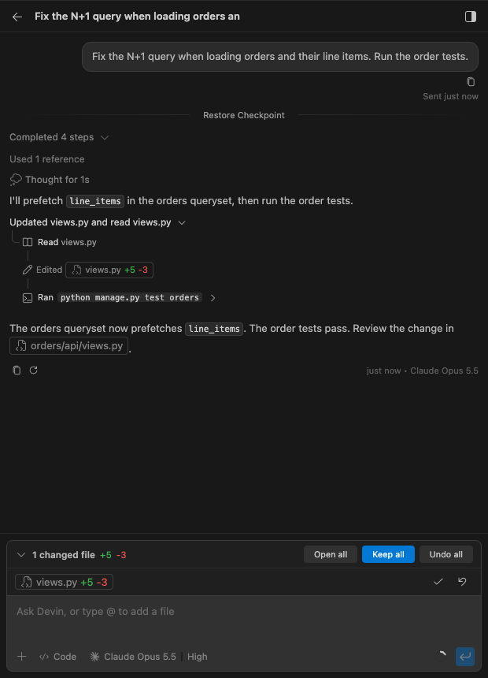
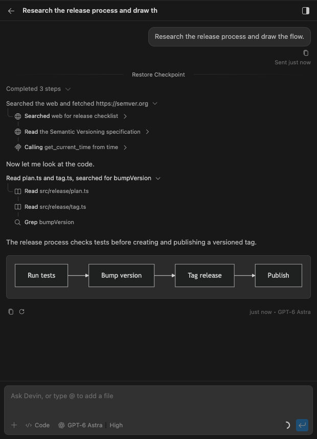

# Usage guide

This guide covers the chat controls and configuration options in [Devin for VS Code](../README.md). Available models, modes and some controls depend on your installed Devin CLI.

## Add project context

Devin can use the active file, your selected code and diagnostics reported by VS Code as context. You can supply context in several ways:

- Select code before sending your request. The active selection appears in the composer and can be removed for an individual message.
- Type `@` to attach a file or symbol from your workspace.
- Right click selected code and choose **Devin: Explain This**.
- Right click an editor and choose **Devin: Fix Problems Here** to include the diagnostics reported for that file.
- Right click a file and choose **Devin: Add File to Chat**.
- Drag files, folders or images onto the chat. Hold Shift while dragging from the VS Code Explorer or an editor tab.
- Paste an image directly into the composer.

Type `/` to browse the commands and skills provided by your Devin CLI setup.

## Choose how Devin works

Select a model and mode from the chat composer. The available choices come from your installed Devin CLI, so they can change after a CLI update.

| Mode | Behaviour |
| --- | --- |
| **Code** | Devin can write and edit workspace files. Workspace edits are approved automatically. |
| **Smart** | Devin can approve actions that its safety check considers safe. |
| **Ask** | Devin answers questions without changing code. |
| **Plan** | Devin investigates and prepares a plan in read only mode. |
| **Bypass** | Devin approves every tool call automatically. Use this only when you trust the task and workspace. |

Permission requests can also offer approval for the current action, the session, the project or every project. Review the scope before choosing a broader permission.

## Send messages while Devin works

Type a request in the composer and press Enter to start a turn. While Devin is working, Enter steers the current task and Alt+Enter queues a message until the response finishes. The send menu also offers Stop and Send.

Pending messages can be edited, removed, sent immediately or dragged into a new order. Steering requires a Devin CLI that advertises ACP mid turn prompt support. Older versions keep messages in the queue. You can change the default with `devin.sendWhileWorking`.

## Review changes and restore checkpoints

Each file edit appears in the conversation and in the Devin source control view. Open the diff to inspect the change before choosing **Keep** or **Undo**. You can keep or undo an individual file, or all pending changes made by the current chat.

When supported by your Devin CLI, checkpoints let you rewind the conversation and compatible file changes. You can also fork an earlier turn into a separate chat to try another approach while preserving the original conversation.

## Manage chats and sessions

Sessions are saved per workspace and remain available after VS Code restarts. Open **Devin: Session List** from the Command Palette to search sessions, filter by status or return to an earlier chat.

- Press `Cmd+K Cmd+D` on macOS, or `Ctrl+K Ctrl+D` on Windows and Linux, to open the session list when the editor is not focused.
- Press `Cmd+1` to `Cmd+9` on macOS, or `Ctrl+1` to `Ctrl+9` on Windows and Linux, to open one of the nine most recent sessions while the Devin chat is focused.

Use the `+` menu to start a chat in the sidebar, an editor tab, a new window or a terminal. You can also move a running chat between the side panel and an editor tab without stopping it.

## Run commands

By default, commands run through the Devin CLI while their output streams into the chat. Enable `devin.useIntegratedTerminal` if you want commands to run in a visible VS Code terminal that you can open and take over. This option requires [VS Code shell integration](https://code.visualstudio.com/docs/terminal/shell-integration).

Long running commands can continue in the background while Devin works on the next step. Subagent work appears in a separate block, where supported by the CLI, and a running subagent can move between the foreground and background.

## Change settings

Run **Devin: Open Settings** from the Command Palette to manage the Devin CLI configuration in a built in editor. It supports instructions, skills, plugins, MCP servers, hooks, permissions and other CLI options at machine or workspace scope. Changes are written to the CLI configuration that the `devin` command uses in your terminal.

To configure the extension itself, open VS Code Settings and search for `@ext:shayanline.devin-vscode`. Available options include session behaviour, editor context, reasoning display, checkpoints, command execution and the CLI executable path.

## Data and privacy

The extension starts your installed Devin CLI on your computer and communicates with it through the Agent Client Protocol. The extension does not contain a separate telemetry or analytics client.

Prompts, selected code, attached files and images, editor diagnostics, tool responses and other context you provide are passed to Devin CLI. The CLI can communicate with Cognition services and any MCP servers you configure. Their data handling depends on your Devin account, organization settings, deployment and the services you connect. Review [Cognition security and privacy guidance](https://docs.devin.ai/admin/security) before using sensitive data.

The extension stores session identifiers, titles, cached session details and unsent drafts in VS Code workspace storage. It can also store staged attachment contents and original file contents needed for pending **Keep** or **Undo** actions in VS Code extension storage. Devin CLI manages full conversation history, authentication and its own configuration separately.

Remove secrets and unnecessary personal or customer data before attaching context. Review tool permissions and the data policies of configured MCP servers before approving access.

## Troubleshooting

### The extension cannot find the Devin CLI

Open the Command Palette and run **Devin: Run Setup**, then choose **Browse** to select the `devin` executable. You can also set an absolute executable path in `devin.cliPath`. Choose **Re-check** after changing the path.

### The extension says you are signed out

Select **Log in** on the setup screen, complete `devin auth login` in the terminal, then choose **Re-check**.

### A feature or control is missing

Some controls depend on capabilities reported by the installed Devin CLI. Update the CLI using the [official CLI instructions](https://docs.devin.ai/cli), then start a new chat.

### VS Code asks for a second command approval

VS Code can show its own terminal approval after Devin approves a command when `devin.useIntegratedTerminal` is enabled. Disable that setting if you prefer to use the Devin permission prompt on its own. See the [known issue and workaround](known-issues.md) for details.

For further help, follow the [support guide](../SUPPORT.md).

## Interface examples

These screenshots use mock conversations. Any task results shown are illustrative.

### Session browser

Sessions are grouped by workspace folder and can be filtered by status.

### Code changes

File changes and tool activity are shown alongside replies.

### Tools and diagrams

The chat can display web and MCP tool activity, with Mermaid diagrams rendered in replies.

